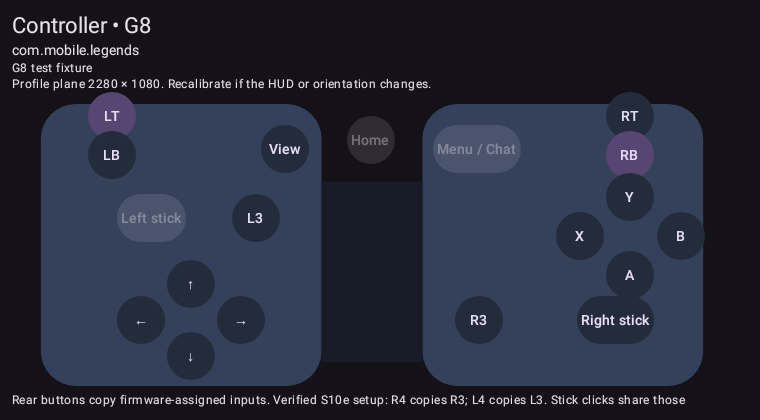
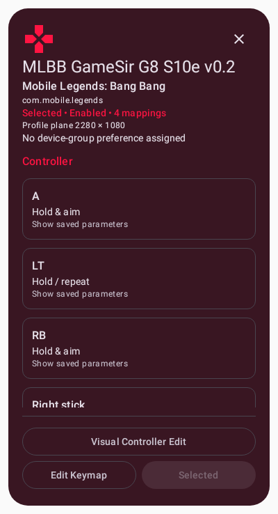

# Visual controller editor (#17)

Open **Visual Controller Edit** from a card menu or mapping details. This launches
EditorActivity with that profile ID; it does not select, activate or create a
profile. The existing EditorUI window, overlay permissions and root connection
are reused. Advanced keyboard/mouse/chord/swipe/macro editing remains available.

A GameSir-inspired split controller diagram and accessible control list show
mapped/unmapped/native-reserved inputs. The diagram scrolls horizontally on
small screens rather than shrinking button hit targets below 48dp. Linux binding
codes are in Advanced input identity. Controls are a presentation catalog, not
proof of current hardware capabilities; verify device mode and stored codes.
Native left movement, Menu/Chat and Home are protected. Right stick opens the
existing camera configuration. Rear-copy controls appear only after explicit
verification of the recorded S10e R4→R3/L4→L3 setup, and edit those same canonical
codes; no separate rear binding or firmware command is created. Other controllers
can reuse the input catalog/list; unsupported hardware is not claimed tested.
Optional physical press-to-identify is not implemented: an unscoped raw listener
would risk accepting a different device. Use tap selection and existing diagnostics.

## Measure, preview, apply, save

Select an input to see its actual saved action. Supported visual modes are touch
(DOWN until release), repeat (60–60000ms), held right-stick aim, and right-stick
camera. Existing aim radius/sensitivity/dead-zone/inversion and fixed-key offset
are retained. Changing interaction mode asks for confirmation. Compound/chord/
macro/swipe or conflicting inputs are preserved and directed to Advanced Editor.

**Place Target** explicitly opens the associated game behind the existing overlay.
The controller panel collapses, and the full touchable overlay consumes taps and
drags instead of passing them to the game. A crosshair and aim-radius circle show
the measured target. Review, nudge, adjust radius or use Advanced coordinates;
**Apply to draft** changes only the selected binding in memory. There are no
synthetic preview touches and no inferred MLBB action names. New inputs start
without coordinates; no shop/purchase/upgrade/skill coordinates are fabricated.
Target cancellation restores the selected draft binding; Undo/Reset remain local.

**Save Profile** validates and writes only that profile. Unchanged serialized lines,
app/enabled/screen metadata, macros, camera/chords and other bindings are retained.
Legacy aliases are understood. Save rejects deleted/renamed or externally changed
profiles instead of overwriting them. Discard, Back, outside-dismiss of confirmation,
activity destruction and configuration recreation never autosave. Drafts are
intentionally discarded on recreation. Device preferences and other profiles are
not rewritten. Export a backup before editing imported presets or re-importing.

The full viewport maps into the saved profile plane. A 2280×1080 full viewport is
identity; other viewport sizes transform back to the saved plane exactly once.
There is no assumed Samsung cutout offset. Placement clears keyboard focus/hides
the IME; the overlay retains full-plane dimensions with ADJUST_NOTHING. Re-measure
if the actual HUD changes. Overlay permission denial uses the existing fullscreen
editor surface with instructions: existing targets/parameters can be adjusted, but
live target placement stays disabled because no real HUD is visible. Permission
is not silently requested; grant it through existing settings and reopen if needed.

## Lifecycle safety

EditorSessionGuard is a lifecycle lease, not a second input-state manager. Existing
TouchPointer observations still invalidate/clean up, but selection/start callbacks
cannot activate while calibration holds a lease. Releasing the last editor resumes
normal preferred-profile resolution. This retains #10/#15's passive unknown-app
behavior. No native grabbing/passthrough changes are introduced.

The editor calls existing pauseMouse and polls appended IPC isMappingPaused before
enabling placement. Readiness comes from InputService's existing touch ledger and
the RuntimeRequestGate lifecycle/cleanup barriers; an unpublished initialization
cannot falsely report idle. No monitor is held across initialization/Binder callbacks.
Older root binaries cannot answer this IPC and safely keep placement disabled; a
future authorized installation must use the matching runtime from this APK.

Integration found that reload advanced the root generation and cancelled an editor
exit's preceding queued resume. Reload now observes the current generation, so
resume→reload both execute while later pause/start still invalidate stale reload.
Visual editor exit uses foreground resolution in automatic mode and the existing
resume/reload path in manual mode. It does not force old controls over unrelated apps.

## Automated evidence and previews

Final validation: **157 Android/Robolectric tests, 0 failures/errors/skips**, debug
assembly successful. Thirteen draft/serialization/coordinate/persistence tests,
11 Compose UI tests across details and visual editor (including two native-rendered
fixture previews), activity Back/destruction, editor leases, foreground restoration,
resume/reload ordering and pause readiness are covered. Existing PR #20 and
controller/native regressions remain green. Both native executable suites pass
(they report pass/fail, not per-case totals); Python 2 branch tests, 3 read-only v0.3
working-tree tests and all v0.1/v0.2/v0.3 checks pass. Diff check passes.

These are local Robolectric renders of synthetic fixtures, not screenshots of
installed S10e software or evidence of physical gameplay. The details preview
renders the reusable dialog content in a test host; dialog interaction tests cover
its actual window. Native snapshot tests regenerate PNGs under app/build/ui-previews.
A discovered unbounded diagram width was corrected; all final checks are green.

## Physical S10e acceptance (pending; no deployment in this sprint)

1. Export profiles/device groups. Later use only an explicitly authorized,
   matching-key parallel xtr.keymapper.debug.s10etest build; preserve the original
   app. Normal local debug APKs target xtr.keymapper.debug, not the parallel ID.
2. Inspect KBM/G8 details without selection. Check close/Back/outside, explicit
   select/edit, TalkBack, font scaling, portrait/landscape, long/empty/deleted records.
3. In Hero Training, open v0.3 visual edit. Check controller labels against actual
   mode; confirm R4/R3 and L4/L3 duplicates only if still programmed that way.
4. Select RB, place on its actual visible HUD center, drag/nudge/resize radius,
   review/apply/save. Verify hold-aim-release plus native movement and LT attack.
5. Move an existing target and Discard, reopen exact original; then Apply/Save,
   reopen/export/import and verify only that binding changed. Type-change Cancel
   must retain aim; no stuck input on entering/exiting or activity recreation.
6. Measure a currently unbound utility only when its HUD is visible. Record the
   landscape screen dimensions, center coordinates, HUD version/date/screenshot
   and physical behavior before declaring it functional. No purchases/ranked matches.
7. Verify View/BTN_SELECT Ultimate upgrade, R4/BTN_THUMBR Skill1, L4/BTN_THUMBL
   Skill2, native Menu/BTN_START Chat, LT repeat, A spell, shoulders, sticks,
   simultaneous input, reconnect and service restart. Test denied overlay/root,
   old/stopped root binary, IME/insets and controller disconnect during editing.
8. MLBB→File Manager→MLBB must still clean up/restore without creation prompts,
   profiles or stale synthetic touches. Calibration must defer activation while open.

## Review and rollback

This PR is stacked on #21 (#16); review/merge #21 first, then retarget this PR to
updated dev and review the focused diff. Neither is merged automatically. Existing
local v0.3 generator/calibration/preset work is preserved outside these branches;
this editor edits imported profiles rather than changing generated presets.

Revert the visual-editor merge commit before reverting the details dependency.
After any later test installation, restore its matching-certificate backed-up APK
with install -r and select the saved v0.3/v0.2 profile if needed. Do not uninstall,
clear data, modify the original app or reset rear-button firmware. Source rollback
alone does not undo explicitly saved user edits: restore the exported profile or
verified profile backup separately. The new IPC is append-only; rollback requires
matching app/root runtime versions.
